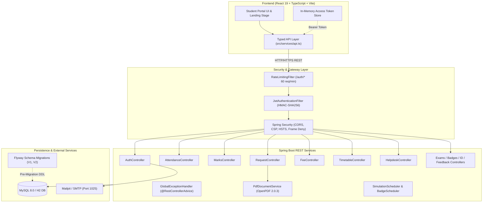

# 🎓 CampusConnect — Full-Stack Student Portal & Campus Platform

[](https://spring.io/projects/spring-boot)
[](https://react.dev/)
[](https://www.typescriptlang.org/)
[](https://www.mysql.com/)
[](https://tailwindcss.com/)
[](https://vitejs.dev/)

**CampusConnect** is an enterprise-grade, student-first campus portal and academic companion designed for higher-education institutions. It combines an engaging, scroll-driven interactive landing experience with a secure, production-ready React client and a high-performance Java Spring Boot REST backend with Flyway-managed MySQL database schemas.

---

## 🏛️ System Architecture



---

## ✨ Key Capabilities & Highlights

### 1. 📊 Attendance Calculator (Bunk Bank)
- **Official Records Single Source of Truth**: Pulls validated records directly from the college database. Direct student write operations are strictly blocked.
- **Bunk Margin & Recovery Formula**: Computes precise margin (classes you can safely miss while remaining $\ge 75\%$) or required recovery classes ($c = \lceil \frac{0.75 \times T - P}{0.25} \rceil$).
- **What-If Simulation Slider**: Real-time hypotheticals without modifying the persistent college attendance record.
- **On-Duty (OD) Integration**: Multi-stage OD approval workflows automatically credit attendance back to official course records.

### 2. 🎯 SRM 2021 Assessment Calculator & CGPA Predictor
- **SRM 2021 Regulation Formula**: Computes composite internal score capped strictly at 50:
  $$\text{Internal (Max 50)} = \min\left(50, \left(\frac{\text{Internal 1} + \text{Internal 2}}{50} \times 40\right) + \text{Assignment}\right)$$
- **Achievable vs. Impossible Target Flags**: Calculates required end-semester exam marks (out of 100) across all weighted course credits. If needed marks exceed 100, flags as impossible and offers one-click realignment to the best achievable target.

### 3. 🗓️ Timetable & `.ics` Calendar Sync
- **College Weekly Grid**: Monday through Saturday period allocation, highlighting active ongoing periods with a real-time **"Now"** indicator.
- **Digital Calendar Export**: One-click download of RFC 5545 `.ics` iCalendar files for native sync with Google Calendar, Apple Calendar, and Outlook.

### 4. 💳 Server-Computed Fees & Mock Sandbox Settlement
- **Server Balance Enforcement**: Client never supplies the payment amount; backend verifies fee structure breakdown against past payments and computes exact balance due.
- **Card Data Masking**: Only the last 4 digits are ever stored (`last4`); full card details are discarded immediately.
- **Idempotency Guarantees**: Prevents double-charging on duplicate requests using idempotency references.
- **Accounts No-Dues Clearance**: Settling the semester balance automatically updates the Accounts department stage in the paperless clearance tracker.

### 5. 📜 Paperless Approvals & OpenPDF Certificates
- **4-Stage Clearance Workflow**: Tracks requests through `Submitted` $\rightarrow$ `Faculty Review` $\rightarrow$ `Admin Approval` $\rightarrow$ `Certificate Ready`.
- **Signed PDF Generation**: Dynamically renders high-resolution official approval letters via OpenPDF containing verification tokens and institutional seal styling.

### 6. 🛡️ Anonymity by Design: Course Feedback
- **Zero-Trace Evaluation**: Feedback ratings and comments are stored in `feedback_responses` without any student identity reference.
- **Duplicate Prevention**: A detached `feedback_submissions` table records receipt tokens purely to block multi-submissions without linking answers to student IDs.

### 7. 🎫 Student Helpdesk & Auto-Assignment
- **Category Routing**: Intelligently routes tickets to appropriate campus departments (Wi-Fi $\rightarrow$ *Campus IT*, Hostel $\rightarrow$ *Hostel Estate & Facilities*, etc.).
- **Abuse Prevention**: Strict rate limit of maximum 5 support tickets per day per authenticated student.

---

## 🔒 Security Architecture & Threat Model

1. **Student-Only Role Enforcement**: Role parameters sent in client payloads are strictly ignored. Every registered account is provisioned as `ROLE_STUDENT`.
2. **In-Memory JWT Access Tokens**: Short-lived (15-minute) tokens reside exclusively in JavaScript memory and are never persisted in `localStorage` or `sessionStorage`.
3. **Rotating Refresh Tokens & Reuse Detection**: Refresh tokens (7 days standard, 30 days remember-me) are transmitted in `httpOnly`, `SameSite=Lax` cookies. If a revoked token is presented, its entire token family is immediately invalidated.
4. **BCrypt Password Hashing**: Passwords hashed with BCrypt at work factor / cost `12`.
5. **Rate Limiting & Anti-Brute-Force**:
   - `RateLimitingFilter`: 60 requests/minute per IP across `/auth/*`.
   - Registration code requests: 5 per hour per register number; 20 per hour per IP.
   - Account lockout: 5 consecutive failed login attempts trigger an automatic 15-minute freeze.
6. **Information Disclosure Prevention**: `GlobalExceptionHandler` conceals internal stack traces, returning standardized JSON payloads (`status`, `error`, `message`).

---

## 📡 REST API Reference

| Endpoint | Method | Auth | Description |
|---|---|---|---|
| `/auth/captcha` | `GET` | Public | Generate dynamic SVG captcha session |
| `/auth/register/request-code` | `POST` | Public | Send 6-digit registration OTP to student email |
| `/auth/register/verify-code` | `POST` | Public | Verify registration OTP and fetch student record |
| `/auth/register/complete` | `POST` | Public | Finalize password and provision student account |
| `/auth/login` | `POST` | Public | Authenticate with register number and captcha |
| `/auth/refresh` | `POST` | Cookie | Rotate refresh token and issue new access token |
| `/auth/logout` | `POST` | Public | Revoke refresh token and clear cookies |
| `/attendance` | `GET` | Bearer | Fetch student attendance records and bunk margins |
| `/marks` | `GET` | Bearer | Fetch student internal assessment marks & CGPA |
| `/marks/predict?target={gpa}` | `GET` | Bearer | Calculate required end-sem marks to reach target GPA |
| `/timetable` | `GET` | Bearer | Fetch weekly academic timetable schedule |
| `/timetable/ics` | `GET` | Bearer | Download RFC 5545 `.ics` calendar export |
| `/fees` | `GET` | Bearer | Fetch tuition fee structure breakdown and balance |
| `/fees/payments` | `GET` | Bearer | Fetch historical fee payment transactions |
| `/fees/pay` | `POST` | Bearer | Process idempotent fee payment in mock sandbox |
| `/fees/receipts/{id}` | `GET` | Bearer | Retrieve fee payment receipt details |
| `/fees/receipts/verify/{token}`| `GET` | Public | Validate digital authenticity of fee receipt |
| `/requests` | `GET` | Bearer | List paperless student requests and approvals |
| `/requests` | `POST` | Bearer | Submit new request (OD letter, No-dues, etc.) |
| `/requests/{id}/document` | `GET` | Bearer | Download OpenPDF-generated official approval letter |
| `/helpdesk` | `GET` | Bearer | List student helpdesk support tickets |
| `/helpdesk` | `POST` | Bearer | Create new ticket (max 5/day per student) |
| `/helpdesk/{id}/comment` | `POST` | Bearer | Add comment to ticket discussion thread |
| `/faculty` | `GET` | Bearer | List faculty directory and office hours |
| `/feedback/forms` | `GET` | Bearer | List active course evaluation feedback forms |
| `/feedback/submit` | `POST` | Bearer | Submit anonymized course evaluation response |
| `/exams` | `GET` | Bearer | Fetch upcoming exam timetable schedules |
| `/badges` | `GET` | Bearer | Fetch earned student badges and streak data |
| `/id-card` | `GET` | Bearer | Generate digital holographic ID card payload |

---

## 🚀 Local Development Setup

### Prerequisites
- **Node.js** v18+ (tested on Node v20/v22)
- **Java JDK** 17+ (tested on OpenJDK 17 and 25)
- **Maven** 3.8+ (or use included `mvnw`)
- **Docker & Docker Compose** (optional, for local MySQL & Mailpit)

### 1. Clone & Setup Environment
```bash
git clone https://github.com/Sandraaapv/CampusConnect.git
cd CampusConnect

# Configure environment variables
cp .env.example .env
```

### 2. Run Database & Mailpit with Docker
```bash
docker compose up -d
```
- **MySQL Database**: `localhost:3306` (database: `campusconnect`, user: `campusconnect`, password: `campusconnect_secret`)
- **Mailpit Web UI**: Open `http://localhost:8025/` to inspect OTP and notification emails.

### 3. Run Backend (Spring Boot)
```bash
cd backend
./mvnw spring-boot:run
```
The REST API will be available at `http://localhost:8080`.

### 4. Run Frontend (React 19 + Vite)
```bash
# In the repository root:
npm install
npm run dev
```
Open `http://localhost:5173/` in your browser.

---

## 🧪 Running Automated Tests

### Backend Unit & Integration Tests (24 Tests)
```bash
cd backend
./mvnw test
```
Includes:
- `AuthServiceTest`: OTP generation, expiry, lockout, rate limiting, and password hashing.
- `Phase4ServicesTest`: Server fee calculations, last-4 card masking, idempotency, anonymized feedback, helpdesk daily caps, and faculty directory.
- `Phase5SecurityTest`: IP rate limiting filter for `/auth/*`, exception advice stack trace masking, and 403/404 scoping.
- `RequestFlowIntegrationTest`: Multi-stage approval state transitions and OpenPDF document generation.
- `DashboardUrgencyTest`, `MarksServiceTest`, `StudyPlannerTest`, and `CaptchaServiceTest`.

### Frontend Tests (Vitest)
```bash
npm test
```

---

## ☁️ Deployment Instructions

### Option 1: Frontend on Vercel
1. Fork or push your repository to GitHub.
2. In the [Vercel Dashboard](https://vercel.com/new), import the repository.
3. Select **Vite** framework preset.
4. Set Environment Variables:
   - `VITE_BACKEND_URL`: Your deployed backend URL (e.g. `https://campusconnect-api.onrender.com`)
   - `VITE_USE_MOCK_API`: `false`
   - `VITE_COLLEGE_EMAIL_DOMAIN`: `campus.test`
   - `VITE_ENABLE_DEMO`: `true`
5. Click **Deploy**.

### Option 2: Backend on Render
1. In the [Render Dashboard](https://dashboard.render.com/), create a new **Web Service**.
2. Connect your repository and select the `backend` subdirectory as the Root Directory.
3. Choose **Docker** environment or **Java** runtime (`./mvnw clean package -DskipTests` and `java -jar target/*.jar`).
4. Set Environment Variables:
   - `SPRING_DATASOURCE_URL`: JDBC URL to your MySQL instance (e.g., from Render PostgreSQL/MySQL or Railway).
   - `SPRING_DATASOURCE_USERNAME`: Database username.
   - `SPRING_DATASOURCE_PASSWORD`: Database password.
   - `JWT_SECRET`: 256-bit secret key string.
   - `CAMPUSCONNECT_FRONTEND_ORIGIN`: Your deployed Vercel frontend URL.

### Option 3: Full Stack on Railway
1. In [Railway](https://railway.app/), create a new project.
2. Add a **MySQL** database service from Railway templates.
3. Add a service from your GitHub repo pointing to `backend/Dockerfile`. Link the MySQL environment variables (`DATABASE_URL`, `MYSQLUSER`, `MYSQLPASSWORD`).
4. Add another service pointing to root directory for the React frontend, setting `VITE_BACKEND_URL` to the backend Railway URL.

---

## 👥 Pre-seeded Demo Credentials

| Role | Register Number | Password | Notes |
|---|---|---|---|
| **Enrolled Student** | `21CS042` | `StudentDemo@2026!` | Pre-seeded with attendance, marks, fees, and requests |
| **New Eligible Record**| `21CSC105` | *(Create via OTP)* | Use to test 3-step registration flow (OTP in Mailpit) |

---

## 📄 License
This project is licensed under the MIT License. See [LICENSE](LICENSE) for details.
